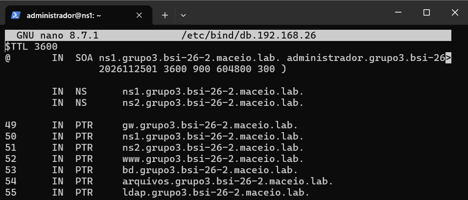
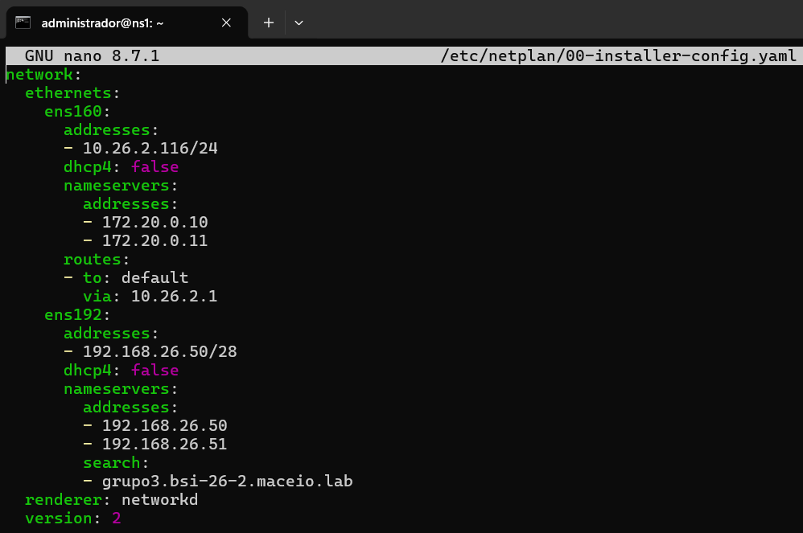

# Configurações da máquina virtual ```ns1```
No projeto, o ns1 (abreviação de Name Server 1) é a máquina virtual configurada com o software BIND9 para atuar como o servidor DNS primário da rede. Ele é o servidor central responsável por traduzir os nomes das máquinas em endereços IP e vice-versa para todas as outras VMs do grupo, permitindo que os serviços se comuniquem pelo nome em vez de dependerem de IPs decorados ou de arquivos ```/etc/hosts``` locais.

### Definição do Hostname

O hostname é o nome único que identifica uma máquina na rede. No projeto, ele é configurado como o FQDN ( Domínio Totalmente Qualificado), que une o nome do serviço ao domínio do grupo, por exemplo, ```ns1.grupo0.bsi-26-2.maceio.lab```. No Projeto Final, cada máquina assume o nome do serviço que hospeda (gw, ns1, ns2, www, bd, arquivos, ldap e cliente). Essa padronização é fundamental porque facilita a administração e o diagnóstico de problemas durante o trabalho em grupo.

```
sudo hostnamectl set-hostname ns1.grupo3.bsi-26-2.maceio.lab
sudo nano /etc/hosts
```

No ```/etc/hosts``` deixe só a própria VM:


### Instalação e configuração do BIND
O BIND (sigla para Berkeley Internet Name Domain) é o software de servidor DNS mais utilizado na internet para traduzir nomes de domínio em endereços IP e vice-versa, originalmente criado na Universidade da Califórnia em Berkeley e atualmente mantido pelo ISC (Internet Systems Consortium).

```
sudo apt-get update
sudo apt-get install -y bind9 bind9-utils dnsutils
```


O arquivo ```/etc/bind/named.conf.options``` define o comportamento global e as regras de segurança do servidor DNS BIND9, estabelecendo quem pode fazer consultas, como resolver nomes externos e onde armazenar dados temporários.


O arquivo ```/etc/bind/named.conf.local``` é utilizado no BIND9 para declarar as zonas locais pelas quais o servidor DNS é responsável de forma autoritativa, informando onde estão armazenados os registros e como ocorre a sincronização com o servidor secundário (ns2).


O arquivo ```/etc/bind/db.grupo3``` é o arquivo de zona direta do Grupo 3, responsável por mapear cada nome de máquina do domínio para o seu respectivo endereço IPv4.


O arquivo ```/etc/bind/db.192.168.26``` é o arquivo de zona reversa do Grupo 3, responsável por realizar o caminho oposto ao da zona direta: traduzir um endereço IPv4 de volta para o seu nome de domínio completo (FQDN), algo essencial para auditoria de logs, verificação de segurança de serviços como SSH e e-mail, e testes de diagnóstico com comandos como dig -x.



### Netplan

O arquivo ```/etc/netplan/00-installer-config.yaml``` é a configuração do Netplan, o utilitário padrão do Ubuntu Server para gerenciar as interfaces de rede do sistema operacional em formato YAML. Ele serve para definir de forma permanente como a máquina virtual se conecta à rede: quais placas de rede estão ativas, se os endereços são fixos (dhcp4: false) ou dinâmicos, qual é o gateway de saída e quais servidores DNS o próprio sistema operacional deve consultar. No final do arquivo, renderer: networkd indica que o serviço systemd-networkd aplica essas regras no sistema, e version: 2 especifica a versão da sintaxe do Netplan.

- Nesta configuração específica do servidor ns1, existem duas placas de rede configuradas (ens160 e ens192), e cada endereço IP tem um papel distinto na comunicação da máquina.
- Na primeira placa de rede, ens160 (voltada para a rede do laboratório/externa), o endereço 10.26.2.116/24 define o IP fixo dessa interface na sub-rede externa com máscara /24. Logo abaixo, os endereços 172.20.0.10 e 172.20.0.11 configurados em nameservers são os servidores DNS externos da infraestrutura do laboratório que essa interface usa para resolver nomes de fora. Em seguida, dentro do bloco routes, o IP 10.26.2.1 (to: default via: 10.26.2.1) estabelece a rota padrão (gateway), indicando por qual roteador o servidor deve enviar todo o tráfego destinado a outras redes e à internet.
- Na segunda placa de rede, ens192 (voltada para a rede interna do Grupo 3), o endereço 192.168.26.50/28 define o IP fixo da própria VM ns1 dentro da sub-rede /28 do Grupo 3. Abaixo dele, na seção nameservers, os IPs 192.168.26.50 e 192.168.26.51 apontam o resolvedor do sistema operacional para os servidores DNS do próprio grupo: o 192.168.26.50 é o próprio ns1 (primário) e o 192.168.26.51 é o ns2 (secundário). Junto com a linha search: [grupo3.bsi-26-2.maceio.lab], essa configuração permite que a máquina complete automaticamente nomes curtos (como ping ldap virando ping ldap.grupo3.bsi-26-2.maceio.lab) e consulte o DNS do grupo.



### Validação
Essa sequência de comandos serve para testar a sintaxe das configurações, aplicar as alterações e confirmar se o servidor DNS primário (ns1) está respondendo corretamente antes de avançar para a configuração do servidor secundário (ns2).
```
sudo named-checkconf
sudo named-checkzone grupo3.bsi-26-2.maceio.lab /etc/bind/db.grupo3
sudo named-checkzone 26.168.192.in-addr.arpa /etc/bind/db.192.168.26
sudo systemctl restart named
sudo systemctl enable named
sudo systemctl status named --no-pager
sudo ufw status
```


