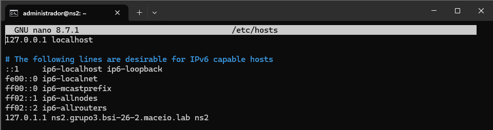
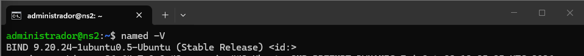
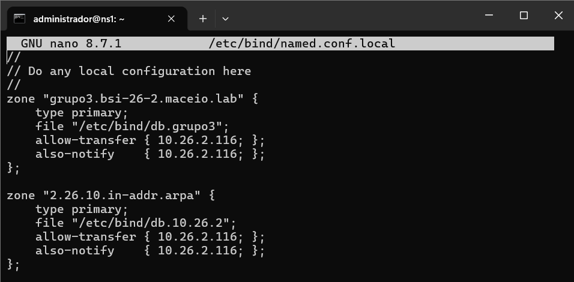

# Configurações da máquina virtual ```ns2```

No projeto, o ns2 é a segunda máquina virtual de DNS do grupo, que também roda o software BIND9, mas assume o papel de servidor DNS secundário. A principal razão de existir do ns2 é eliminar um ponto único de falha na rede. Se o grupo dependesse apenas do ns1 e essa máquina travasse, reiniciasse ou tivesse o serviço named parado, nenhuma outra VM conseguiria resolver nomes, derrubando o login unificado via LDAP, o acesso ao banco de dados e os demais serviços. Com o ns2 configurado como segundo servidor DNS nas placas de rede de todas as máquinas, ele assume as respostas automaticamente caso o ns1 fique indisponível.  

### Definição do Hostname

O hostname é o nome único que identifica uma máquina na rede. No projeto, ele é configurado como o FQDN ( Domínio Totalmente Qualificado), que une o nome do serviço ao domínio do grupo, por exemplo, ```ns2.grupo0.bsi-26-2.maceio.lab```. 

```
sudo hostnamectl set-hostname ns2.grupo3.bsi-26-2.maceio.lab
sudo nano /etc/hosts
```

No ```/etc/hosts``` deixe só a própria VM:



### Instalação e configuração do BIND
O BIND é o software de servidor DNS mais utilizado na internet para traduzir nomes de domínio em endereços IP e vice-versa.

```
sudo apt-get update
sudo apt-get install -y bind9 bind9-utils dnsutils
```



### Use o mesmo ```named.conf.options``` do ns1. 

<!--adicionar imagem aqui-->

### No ```/etc/bind/named.conf.local``` declare as zonas como secundárias

No ns2, as zonas precisam ser configuradas como type secondary; para que ele atue como uma réplica sincronizada e somente leitura do ns1, garantindo consistência automática dos dados e evitando falhas humanas de manutenção.




### Validação

Essa sequência de comandos verifica se a sintaxe do servidor secundário (ns2) está correta, se o serviço iniciou sem falhas e se ele conseguiu baixar automaticamente uma cópia das zonas direta e reversa a partir do servidor primário (ns1).

```
sudo named-checkconf
sudo systemctl restart named
sudo journalctl -u named --no-pager -n 20 | grep -i transfer   # "Transfer completed" nas duas zonas
ls -l /var/cache/bind/                                         # db.grupo3 e db.10.26.2
dig @127.0.0.1 ldap.grupo3.bsi-26-2.maceio.lab +short          # 10.26.2.120
```
