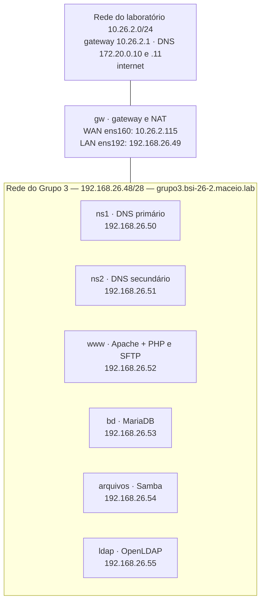

# Projeto Final LSOR

**INSTITUTO FEDERAL DE EDUCAÇÃO, CIÊNCIA E TECNOLOGIA DE ALAGOAS (IFAL) — Campus Maceió**
- **Curso:** Bacharelado em Sistemas de Informação (BSI)
- **Disciplina:** Laboratório de Sistemas Operacionais e Redes (LSOR) — 2026.2
- **Professor:** Alaelson de Castro Jatobá Neto
- **Turma:** bsi-26-2 · **Grupo:** 3
- **Rede do grupo (LAN, `ens192`):** `192.168.26.48/28` · **Domínio:** `grupo3.bsi-26-2.maceio.lab`
- **Rede do laboratório (`ens160`):** `10.26.2.0/24`, gateway `10.26.2.1`, DNS `172.20.0.10` e `172.20.0.11`
- **Apresentação:** 02/12/2026
- **Data deste relatório:** 25/11/2026

| Integrante | Matrícula | Usuário (LDAP) | uidNumber |
|:--|:--|:--|:--:|
| Sarah Amorim dos Santos | 2024014201 | sarah.amorim | 10001 |
| Pedro Henrique Cavalcante Rocha | 2023007730 | pedro.rocha | 10002 |
| Marco Bueno | 2021008953 | marco.bueno | 10003 |
| Arthur Soares Silva | 2021008710 | arthur.soares | 10004 |
| (usuário restrito a SFTP) | — | novato | 10100 |

> Nenhuma senha, chave privada ou *hash* `{SSHA}` é publicada neste repositório.

---

## 1. Apresentação

Na Etapa 1, o grupo montou uma rede privada com IPs fixos, nomes no domínio do grupo e um gateway NAT. No Projeto Final, essa rede vira um ambiente de serviços completo, como o de uma pequena empresa, com **login unificado**: cada integrante tem uma única conta e senha, guardadas no LDAP, usadas em todas as VMs e serviços.

Nesta fase, o projeto usa as **7 VMs** fornecidas pelo professor, cada uma com duas placas: a `ens160`, na rede do laboratório (`10.26.2.x`), por onde as VMs são acessadas, e a `ens192`, na LAN do grupo (`192.168.26.48/28`), onde os serviços conversam entre si.

## 2. 🎯 Objetivo

Transformar a rede da Etapa 1 em um ambiente de serviços com login unificado, de modo que:

- o `gw` faça roteamento e **NAT** da rede do grupo;
- o DNS responda pelo domínio do grupo, com servidor **primário e secundário** e zona direta e reversa;
- o **OpenLDAP** guarde usuários e grupos POSIX, e as 7 VMs autentiquem nele via **SSSD**;
- o servidor de arquivos publique pastas por **Samba**, com permissões pelo grupo do LDAP;
- o servidor web (Apache + PHP) e o banco (MariaDB) formem uma aplicação em duas camadas, com área `/admin` autenticada no LDAP e site enviado por **SFTP**;
- o usuário `novato` tenha acesso **somente por SFTP**, preso a uma pasta do `www`;
- cada serviço seja **testado e documentado com evidências**.

**Escopo de 2026.2**

| Obrigatório | Bônus |
|:--|:--|
| Gateway (NAT), DNS primário e secundário, LDAP + login unificado (SSSD), arquivos (Samba), web e banco, SFTP restrito | Firewall no `gw` (`FORWARD` com política `DROP`), TLS no LDAP (StartTLS), HTTPS no `www`, backup automático (`cron`) |

## 3. Topologia

**Figura 1:** Topologia do grupo. Todas as VMs também têm a `ens160` na rede do laboratório (acesso por VPN), que não aparece no diagrama.



**Figura 2:** Login unificado.


Diagrama editável: <link do Lucid ou arquivo>

## 4. Endereçamento, nomes e serviços

- Rede do grupo: `192.168.26.48/28` (255.255.255.240) · Broadcast: `192.168.26.63`
- Rede do laboratório: `10.26.2.0/24` · Gateway: `10.26.2.1` · DNS: `172.20.0.10` e `172.20.0.11`
- Os nomes do DNS do grupo apontam para os IPs da **LAN** (`ens192`).
- Rota padrão: as VMs mantêm a rota padrão pela `ens160` (`10.26.2.1`), para o acesso por VPN continuar funcionando. O teste do gateway usa uma rota temporária pelo `gw` (teste 1, seção 14). <confirmar com o professor>

| VM | Serviço (hostname) | `ens160` (laboratório) | `ens192` (LAN do grupo) | FQDN |
|:--|:--|:--|:--|:--|
| VM1 | `gw` (gateway e NAT) | 10.26.2.115 | 192.168.26.49 | gw.grupo3.bsi-26-2.maceio.lab |
| VM2 | `ns1` (DNS primário) | 10.26.2.116 | 192.168.26.50 | ns1.grupo3.bsi-26-2.maceio.lab |
| VM3 | `ns2` (DNS secundário) | 10.26.2.117 | 192.168.26.51 | ns2.grupo3.bsi-26-2.maceio.lab |
| VM4 | `www` (Apache + PHP + SFTP) | 10.26.2.118 | 192.168.26.52 | www.grupo3.bsi-26-2.maceio.lab |
| VM5 | `bd` (MariaDB) | 10.26.2.119 | 192.168.26.53 | bd.grupo3.bsi-26-2.maceio.lab |
| VM6 | `arquivos` (Samba) | 10.26.2.120 | 192.168.26.54 | arquivos.grupo3.bsi-26-2.maceio.lab |
| VM7 | `ldap` (OpenLDAP) | 10.26.2.121 | 192.168.26.55 | ldap.grupo3.bsi-26-2.maceio.lab |

Não há VM `cliente`: os testes são feitos de uma VM da LAN (seção 14).

## 5. Hardware das VMs

| VM | Memória | vCPUs | Disco |
|:--|:--|:--|:--|
| gw | | | |
| ns1 | | | |
| ns2 | | | |
| www | | | |
| bd | | | |
| arquivos | | | |
| ldap | | | |

## 6. Preparação do ambiente

### 6.1 Renomear as VMs e revisar o Netplan

```bash
sudo hostnamectl set-hostname ns1.grupo3.bsi-26-2.maceio.lab
ls /etc/netplan/          # deve haver um único arquivo, com dhcp4: false
ip -br addr
ip route                  # deve haver uma única rota padrão
```

Saída da `ns1` (VM2), como exemplo:

```text
lo               UNKNOWN        127.0.0.1/8 ::1/128
ens160           UP             10.26.2.116/24 fe80::20c:29ff:fe9b:ede1/64
ens192           UP             192.168.26.50/28 fe80::20c:29ff:fe9b:edeb/64
default via 10.26.2.1 dev ens160 proto static
10.26.2.0/24 dev ens160 proto kernel scope link src 10.26.2.116
192.168.26.48/28 dev ens192 proto kernel scope link src 192.168.26.50
```

Cada VM tem dois IPv4, um em cada placa, e uma única rota padrão, pela `ens160`.

```text
<colar as saídas das demais VMs>
```

### 6.2 Remover as contas locais da Etapa 1

As contas dos integrantes criadas na Etapa 1 são removidas (mantendo o `administrador`), senão o Linux usa a conta local e ignora a do LDAP.

```bash
<comandos usados>
getent passwd | grep -c <usuário>
```

```text
<colar a saída>
```

### 6.3 Snapshots

Snapshot de cada VM antes de configurar cada serviço: <registrar print ou lista>.

---

## 7. Gateway — `gw`

**Requisitos:** `ip_forward` persistente e NAT só para a rede do grupo, saindo pela `ens160`. O firewall em `FORWARD` com política `DROP` é bônus.

```bash
echo 'net.ipv4.ip_forward=1' | sudo tee /etc/sysctl.d/99-forward.conf
sudo sysctl --system
sudo apt-get install -y iptables-persistent
sudo iptables -t nat -A POSTROUTING -s 192.168.26.48/28 -o ens160 -j MASQUERADE
sudo netfilter-persistent save
```

Verificação:

```bash
sudo sysctl net.ipv4.ip_forward
sudo iptables -t nat -L POSTROUTING -n -v
```

```text
net.ipv4.ip_forward = 1
Chain POSTROUTING (policy ACCEPT 15 packets, 3348 bytes)
 pkts bytes target     prot opt in     out     source               destination
    0     0 MASQUERADE  all  --  *      ens160  192.168.26.48/28     0.0.0.0/0
```

**O que a saída comprova:** o encaminhamento de pacotes está ativo e o NAT só traduz a rede do grupo (`192.168.26.48/28`) na saída pela `ens160`.

### 7.1 Firewall (bônus)

- [ ] `FORWARD` com política `DROP`

```bash
sudo iptables -P FORWARD DROP
sudo iptables -A FORWARD -m conntrack --ctstate ESTABLISHED,RELATED -j ACCEPT
sudo iptables -A FORWARD -i ens192 -o ens160 -s 192.168.26.48/28 -j ACCEPT
sudo netfilter-persistent save
```

```text
<colar a saída de sudo iptables -L -n -v, se feito>
```

## 8. DNS — `ns1` (primário) e `ns2` (secundário)

### 8.1 `ns1`: opções e zonas

`/etc/bind/named.conf.options` (o mesmo arquivo no `ns1` e no `ns2`):

```text
acl grupo { 192.168.26.48/28; localhost; };

options {
    directory "/var/cache/bind";
    listen-on-v6 { none; };

    allow-query     { grupo; };
    allow-recursion { grupo; };
    allow-transfer  { none; };

    forwarders { 172.20.0.10; 172.20.0.11; };
    dnssec-validation no;
};
```

`/etc/bind/named.conf.local`:

```text
zone "grupo3.bsi-26-2.maceio.lab" {
    type primary;
    file "/etc/bind/db.grupo3";
    allow-transfer { 192.168.26.51; };
    also-notify    { 192.168.26.51; };
};

zone "26.168.192.in-addr.arpa" {
    type primary;
    file "/etc/bind/db.192.168.26";
    allow-transfer { 192.168.26.51; };
    also-notify    { 192.168.26.51; };
};
```

### 8.2 Arquivos de zona

`/etc/bind/db.grupo3`:

```text
$TTL 3600
@       IN  SOA ns1.grupo3.bsi-26-2.maceio.lab. administrador.grupo3.bsi-26-2.maceio.lab. (
                2026112501  ; serial (AAAAMMDDnn)
                3600        ; refresh
                900         ; retry
                604800      ; expire
                300 )       ; TTL negativo

        IN  NS      ns1.grupo3.bsi-26-2.maceio.lab.
        IN  NS      ns2.grupo3.bsi-26-2.maceio.lab.

gw       IN  A   192.168.26.49
ns1      IN  A   192.168.26.50
ns2      IN  A   192.168.26.51
www      IN  A   192.168.26.52
bd       IN  A   192.168.26.53
arquivos IN  A   192.168.26.54
ldap     IN  A   192.168.26.55
```

`/etc/bind/db.192.168.26`:

```text
$TTL 3600
@       IN  SOA ns1.grupo3.bsi-26-2.maceio.lab. administrador.grupo3.bsi-26-2.maceio.lab. (
                2026112501 3600 900 604800 300 )

        IN  NS      ns1.grupo3.bsi-26-2.maceio.lab.
        IN  NS      ns2.grupo3.bsi-26-2.maceio.lab.

49      IN  PTR     gw.grupo3.bsi-26-2.maceio.lab.
50      IN  PTR     ns1.grupo3.bsi-26-2.maceio.lab.
51      IN  PTR     ns2.grupo3.bsi-26-2.maceio.lab.
52      IN  PTR     www.grupo3.bsi-26-2.maceio.lab.
53      IN  PTR     bd.grupo3.bsi-26-2.maceio.lab.
54      IN  PTR     arquivos.grupo3.bsi-26-2.maceio.lab.
55      IN  PTR     ldap.grupo3.bsi-26-2.maceio.lab.
```

### 8.3 `ns2`: zonas secundárias

`/etc/bind/named.conf.local`:

```text
zone "grupo3.bsi-26-2.maceio.lab" {
    type secondary;
    primaries { 192.168.26.50; };
    file "/var/cache/bind/db.grupo3";
};

zone "26.168.192.in-addr.arpa" {
    type secondary;
    primaries { 192.168.26.50; };
    file "/var/cache/bind/db.192.168.26";
};
```

### 8.4 Validação

```bash
sudo named-checkconf
sudo named-checkzone grupo3.bsi-26-2.maceio.lab /etc/bind/db.grupo3
sudo named-checkzone 26.168.192.in-addr.arpa /etc/bind/db.192.168.26
sudo systemctl restart named
```

Saída no `ns1`:

```text
zone grupo3.bsi-26-2.maceio.lab/IN: loaded serial 2026112501
OK
zone 26.168.192.in-addr.arpa/IN: loaded serial 2026112501
OK
```

Transferência de zona no `ns2` (`journalctl -u named | grep -i transfer`):

```text
zone grupo3.bsi-26-2.maceio.lab/IN: transferred serial 2026112501
zone 26.168.192.in-addr.arpa/IN: transferred serial 2026112501
```

Arquivos criados no `ns2` (`ls -l /var/cache/bind/`): `db.grupo3` e `db.192.168.26`.

**O que a saída comprova:** as duas zonas carregam sem erro no `ns1`, e o `ns2` copiou as duas, com o mesmo serial.

### 8.5 DNS de todas as VMs apontando para ns1 e ns2

Bloco `nameservers` na `ens192` de cada VM:

```yaml
      nameservers:
        search: [grupo3.bsi-26-2.maceio.lab]
        addresses: [192.168.26.50, 192.168.26.51]
```

```bash
resolvectl status
```

```text
<colar a saída>
```

## 9. LDAP — `ldap`

Base: `dc=grupo3,dc=bsi-26-2,dc=maceio,dc=lab`

```bash
sudo apt-get install -y slapd ldap-utils
sudo dpkg-reconfigure slapd      # domínio: grupo3.bsi-26-2.maceio.lab
sudo slapcat | grep ^dn
```

```text
<colar a saída>
```

### 9.1 Estrutura, grupos e usuários

| Grupo | gidNumber | Membros | Uso |
|:--|:--:|:--|:--|
| `lsor-g3` | 10000 | todos os integrantes | `sudo`, pasta do grupo, site e `/admin` |
| `sftpusers` | 10001 | `novato` | só SFTP, numa pasta própria do `www` |

Os integrantes têm `uidNumber` a partir de 10001 e `loginShell: /bin/bash`. O `novato` tem `uidNumber: 10100` e `loginShell: /usr/sbin/nologin`.

LDIF usado (**sem** o campo `userPassword`):

```ldif
dn: ou=usuarios,dc=grupo3,dc=bsi-26-2,dc=maceio,dc=lab
objectClass: organizationalUnit
ou: usuarios

dn: ou=grupos,dc=grupo3,dc=bsi-26-2,dc=maceio,dc=lab
objectClass: organizationalUnit
ou: grupos

dn: cn=lsor-g3,ou=grupos,dc=grupo3,dc=bsi-26-2,dc=maceio,dc=lab
objectClass: posixGroup
cn: lsor-g3
gidNumber: 10000
memberUid: nome.sobrenome
# ... um memberUid por integrante

dn: uid=nome.sobrenome,ou=usuarios,dc=grupo3,dc=bsi-26-2,dc=maceio,dc=lab
objectClass: inetOrgPerson
objectClass: posixAccount
objectClass: shadowAccount
uid: nome.sobrenome
cn: Nome Completo
sn: Sobrenome
mail: nome.sobrenome@grupo3.bsi-26-2.maceio.lab
uidNumber: 10001
gidNumber: 10000
homeDirectory: /home/nome.sobrenome
loginShell: /bin/bash
# userPassword omitido (gerado com slappasswd)
```

```bash
ldapadd -x -D cn=admin,dc=grupo3,dc=bsi-26-2,dc=maceio,dc=lab -W -f base.ldif
ldapsearch -x -LLL -H ldap://ldap.grupo3.bsi-26-2.maceio.lab \
  -b dc=grupo3,dc=bsi-26-2,dc=maceio,dc=lab "(objectClass=posixAccount)" uid uidNumber gidNumber
```

```text
<colar as saídas>
```

### 9.2 TLS (StartTLS) — bônus

- [ ] CA do grupo e certificado para `ldap.grupo3.bsi-26-2.maceio.lab`
- [ ] `olcTLSCACertificateFile`, `olcTLSCertificateFile` e `olcTLSCertificateKeyFile` em `cn=config`
- [ ] `ca-grupo3.crt` nas 7 VMs + `update-ca-certificates`

```bash
ldapsearch -x -ZZ -H ldap://ldap.grupo3.bsi-26-2.maceio.lab \
  -b dc=grupo3,dc=bsi-26-2,dc=maceio,dc=lab "(objectClass=posixAccount)" uid
```

> A chave da CA não vai para o GitHub.

## 10. Login unificado nas 7 VMs (SSSD)

```bash
sudo apt-get install -y sssd-ldap libnss-sss libpam-sss ldap-utils
sudo nano /etc/sssd/sssd.conf
sudo chmod 600 /etc/sssd/sssd.conf
sudo systemctl restart sssd
sudo pam-auth-update --enable mkhomedir
```

`/etc/sssd/sssd.conf` (versão **sem TLS**; com o bônus, usar as linhas de StartTLS):

```ini
[sssd]
services = nss, pam
domains = grupo3

[domain/grupo3]
id_provider = ldap
auth_provider = ldap
ldap_uri = ldap://ldap.grupo3.bsi-26-2.maceio.lab
ldap_search_base = dc=grupo3,dc=bsi-26-2,dc=maceio,dc=lab
cache_credentials = true
ldap_auth_disable_tls_never_use_in_production = true
```

Login por senha no SSH liberado (`PasswordAuthentication yes` no `sshd_config`).

`sudo` pelo grupo do LDAP (`/etc/sudoers.d/lsor-g3`):

```text
%lsor-g3 ALL=(ALL:ALL) ALL
```

Verificação (repetir em **cada** VM):

```bash
getent passwd nome.sobrenome
id nome.sobrenome
grep nome.sobrenome /etc/passwd
```

```text
<colar as saídas; o grep não deve retornar nada: a conta não é local>
```

| VM | getent | id (lsor-g3) | login SSH | sudo |
|:--|:--:|:--:|:--:|:--:|
| gw | | | | |
| ns1 | | | | |
| ns2 | | | | |
| www | | | | |
| bd | | | | |
| arquivos | | | | |
| ldap | | | | |

O `administrador` local foi mantido em todas as VMs (acesso de emergência).

## 11. Servidor de arquivos — `arquivos` (Samba)

| Compartilhamento | Caminho | Acesso |
|:--|:--|:--|
| `publico` | `/srv/arquivos/publico` | leitura para todos, inclusive convidado; escrita para `lsor-g3` |
| `grupo3` | `/srv/arquivos/grupo3` | leitura e escrita só para `lsor-g3` |

A configuração foi feita em duas etapas: primeiro com uma conta local criada só no `arquivos` (sem login unificado) e depois com as contas e o grupo do LDAP. A configuração final tem só a segunda etapa, e a conta local da primeira foi removida.

```bash
sudo mkdir -p /srv/arquivos/publico /srv/arquivos/grupo3
sudo chown :lsor-g3 /srv/arquivos/publico /srv/arquivos/grupo3
sudo chmod 2775 /srv/arquivos/publico
sudo chmod 2770 /srv/arquivos/grupo3
sudo smbpasswd -a nome.sobrenome      # mesma senha do LDAP, um por integrante
testparm
```

Trecho do `smb.conf`:

```text
<colar os blocos [publico] e [grupo3] com valid users, force group, create mask 0660 e directory mask 2770>
```

```text
<colar as saídas>
```

## 12. Servidor web e banco de dados — `www` e `bd`

### 12.1 `bd` (MariaDB)

```bash
sudo apt-get install -y mariadb-server
# bind-address = 192.168.26.53
# <criar o banco "projeto" com criar-banco.sql>
# <usuário da aplicação restrito ao IP do www (192.168.26.52), com SELECT/INSERT/UPDATE/DELETE>
```

```text
<colar: SHOW DATABASES; SHOW GRANTS FOR '<usuário>'@'192.168.26.52'; (sem o hash da senha)>
```

### 12.2 `www` (Apache + PHP)

```bash
sudo apt-get install -y apache2 php php-mysql libapache2-mod-php
sudo a2enmod authnz_ldap ldap
```

```text
<colar o virtual host www.grupo3.bsi-26-2.maceio.lab, sem senhas>
```

- Pasta do site: grupo `lsor-g3`, permissão `2775`, para qualquer integrante poder atualizá-la.
- Envio do site por SFTP, com a conta do LDAP.
- Área `/admin`: autenticação no LDAP, só para `lsor-g3`. Sem TLS: sem `STARTTLS` no `AuthLDAPURL` e sem `LDAPTrustedGlobalCert`.
- Aplicação: site demo com as adaptações do grupo (o `config.php` **não** vai para o GitHub).

## 13. SFTP restrito — `www`

O `novato` só envia arquivos para `/srv/sftp/novato/arquivos` no `www`, preso a essa pasta (`ChrootDirectory`) e sem terminal (`ForceCommand internal-sftp`), pelo grupo `sftpusers` do LDAP.

Trecho final do `sshd_config`:

```text
Match Group sftpusers
    ChrootDirectory /srv/sftp/%u
    ForceCommand internal-sftp
    AllowTcpForwarding no
    X11Forwarding no
```

```bash
sudo mkdir -p /srv/sftp/novato/arquivos
sudo chown root:root /srv/sftp/novato && sudo chmod 755 /srv/sftp/novato
sudo chown novato:sftpusers /srv/sftp/novato/arquivos
sudo sshd -t && sudo systemctl restart ssh
```

```text
<colar as saídas>
```

---

## 14. Testes

Registre, para cada teste, **o comando, a saída (ou print) e uma frase dizendo o que ela comprova**. Como não há VM `cliente`, os testes são feitos de uma VM da LAN: <VM usada nos testes>, com `dnsutils`, `ldap-utils`, `smbclient` e `lynx` instalados. Todos os testes são executados ao vivo na apresentação (02/12). Cada integrante deve saber explicar pelo menos um serviço.

| # | Serviço | Teste | Resultado esperado | Status |
|:--:|:--|:--|:--|:--:|
| 1 | Gateway | Rota temporária pelo `gw` e `ping -c 2 1.1.1.1` com `traceroute -n 1.1.1.1` (comandos abaixo) | Primeiro salto `192.168.26.49`; contador do `MASQUERADE` sobe no `gw` | ☐ |
| 2 | DNS | `dig www.grupo3.bsi-26-2.maceio.lab` | IP `192.168.26.52`, com a flag `aa` | ☐ |
| 3 | DNS | `dig -x 192.168.26.55 +short` | `ldap.grupo3.bsi-26-2.maceio.lab.` | ☐ |
| 4 | DNS | `dig @192.168.26.50 grupo3.bsi-26-2.maceio.lab SOA +short` e o mesmo com `@192.168.26.51` | Mesmo serial nos dois servidores | ☐ |
| 5 | DNS | Parar o `named` do `ns1` e repetir o teste 2 | O `ns2` responde sozinho | ☐ |
| 6 | LDAP | `ldapsearch -x -LLL -H ldap://ldap -b dc=grupo3,dc=bsi-26-2,dc=maceio,dc=lab uid` | Integrantes e `novato` listados | ☐ |
| 7 | Login | `ssh nome.sobrenome@www`, `@bd` e `@arquivos`, com `id` e `sudo -l` | Mesma senha nas três; grupo `lsor-g3`; `sudo` liberado | ☐ |
| 8 | Login | Trocar a senha com `ldappasswd` no `ldap` e repetir o teste 7 | A senha nova vale em todas as VMs | ☐ |
| 9 | Samba | `smbclient //arquivos/publico -N -c ls` e `smbclient //arquivos/grupo3 -U nome.sobrenome -c 'put arquivo.txt'` | Convidado lê o `publico`; integrante grava no `grupo3`; `novato` negado | ☐ |
| 10 | Samba | `ssh nome.sobrenome@arquivos 'ls -l /srv/arquivos/grupo3'` | O arquivo do teste 9 pertence ao integrante e ao grupo `lsor-g3` | ☐ |
| 11 | Web | `curl -s http://www.grupo3.bsi-26-2.maceio.lab/` | Página com "Conectado ao MariaDB … em bd…" | ☐ |
| 12 | Web | `curl -o /dev/null -w '%{http_code}\n' http://www/admin/`, sem e com `-u nome.sobrenome` | 401 sem senha; 200 com o integrante | ☐ |
| 13 | Web | `lynx http://www/admin/` com a conta de um integrante para cadastrar um registro, e `SELECT` no `bd` | Registro gravado no banco | ☐ |
| 14 | SFTP | `sftp novato@www` e depois `ssh novato@www` | SFTP só na pasta `arquivos`; SSH recusado | ☐ |

Comandos do teste 1, na VM de testes (a rota some ao reiniciar e não afeta o acesso por VPN):

```bash
sudo apt-get install -y traceroute
sudo ip route add 1.1.1.1/32 via 192.168.26.49 dev ens192
ping -c 2 1.1.1.1
traceroute -n 1.1.1.1
sudo ip route del 1.1.1.1/32
```

E no `gw`: `sudo iptables -t nat -L POSTROUTING -n -v`.

### Evidências

#### Teste 1
```bash
<comando>
```
```text
<saída>
```
**O que comprova:** <frase>

*(repetir o bloco para os testes 2 a 14)*

---

## 15. Problemas encontrados

| Problema | Causa | Como foi resolvido |
|:--|:--|:--|
| BIND configurado nas VMs erradas (`ns1` na VM1 e `ns2` na VM2) | A VM1 é o `gw`; só foi percebido ao ver a planilha de interfaces | BIND removido da VM1, VM2 virou `ns1` e VM3 virou `ns2`, com as zonas refeitas na LAN `192.168.26.48/28` |
| `ens192` sem IPv4 nas VMs | Placa da LAN sem endereço configurado | IP da LAN configurado no Netplan, sem alterar a rota padrão |
| | | |

## 16. Desafios opcionais realizados

- [ ] Firewall com `FORWARD` em `DROP`
- [ ] TLS no LDAP
- [ ] HTTPS no `www`
- [ ] Backup automático (`mysqldump` e `slapcat` com `cron`)
- [ ] E-mail (Postfix + Dovecot) (não realizado: sem VM livre)

## 17. Conclusão

<o que foi implantado, o que funcionou, o que ficou pendente e o que o grupo aprendeu>

## 18. Referências

[1] NETFILTER PROJECT. **iptables(8)** e **iptables-extensions(8)**. <https://ipset.netfilter.org/iptables-extensions.man.html>
[2] CANONICAL. **Configuring networks**. Ubuntu Server documentation. <https://ubuntu.com/server/docs/configuring-networks>
[3] INTERNET SYSTEMS CONSORTIUM. **BIND 9 Administrator Reference Manual**. <https://bind9.readthedocs.io/>
[4] CANONICAL. **Domain Name Service (DNS)**. <https://ubuntu.com/server/docs/how-to/networking/install-dns/>
[5] MOCKAPETRIS, P. **RFC 1034** e **RFC 1035**. IETF, 1987. <https://www.rfc-editor.org/rfc/rfc1034> · <https://www.rfc-editor.org/rfc/rfc1035>
[6] ELZ, R.; BUSH, R. **RFC 2181**. IETF, 1997. <https://www.rfc-editor.org/rfc/rfc2181>
[7] CANONICAL. **Install and configure LDAP**. <https://documentation.ubuntu.com/server/how-to/openldap/install-openldap>
[8] OPENLDAP FOUNDATION. **OpenLDAP Software Administrator's Guide**. <https://www.openldap.org/doc/admin26/>
[9] HOWARD, L. **RFC 2307**. IETF, 1998. <https://www.rfc-editor.org/rfc/rfc2307>
[10] CANONICAL. **How to set up SSSD with LDAP**. <https://documentation.ubuntu.com/server/how-to/sssd/with-ldap>
[11] SSSD PROJECT. **sssd-ldap(5)**. <https://manpages.ubuntu.com/manpages/noble/man5/sssd-ldap.5.html>
[12] CANONICAL. **Set up Samba as a file server**. <https://ubuntu.com/server/docs/how-to/samba/file-server/>
[13] OPENBSD PROJECT. **sshd_config(5)**. <https://man.openbsd.org/sshd_config>
[14] APACHE SOFTWARE FOUNDATION. **Apache HTTP Server 2.4 — Virtual Hosts** e **mod_authnz_ldap**. <https://httpd.apache.org/docs/2.4/>
[15] MARIADB FOUNDATION. **Configuring MariaDB for Remote Client Access**. <https://mariadb.com/kb/en/configuring-mariadb-for-remote-client-access/>
[16] CANONICAL. **Mail services** (Postfix e Dovecot). <https://documentation.ubuntu.com/server/how-to/mail-services>
[17] KUROSE, James F.; ROSS, Keith W. **Redes de Computadores e a Internet**. 8. ed. Pearson, 2022.
[18] LACROIX, Jay. **Mastering Ubuntu Server**. 4. ed. Packt Publishing, 2023.
