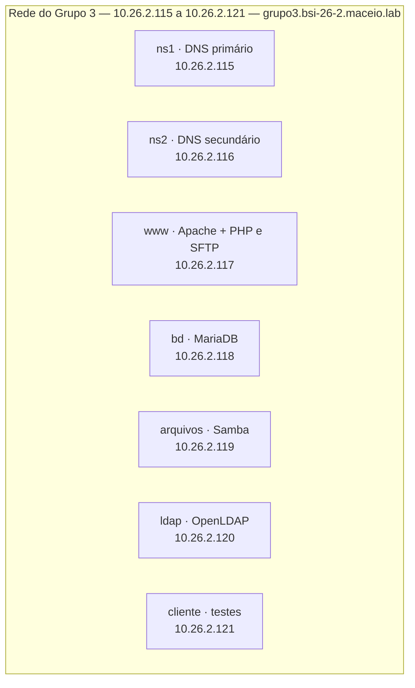

# Projeto Final LSOR

**INSTITUTO FEDERAL DE EDUCAÇÃO, CIÊNCIA E TECNOLOGIA DE ALAGOAS (IFAL) — Campus Maceió**
- **Curso:** Bacharelado em Sistemas de Informação (BSI)
- **Disciplina:** Laboratório de Sistemas Operacionais e Redes (LSOR) — 2026.2
- **Professor:** Alaelson de Castro Jatobá Neto
- **Turma:** bsi-26-2 · **Grupo:** 3
- **Rede do grupo:** `10.26.2.115` a `10.26.2.121` (7 VMs) · **Máscara:**  · **Domínio:** `grupo3.bsi-26-2.maceio.lab`
- **Apresentação:** 02/12/2026
- **Data deste relatório:** 19/11/2026

| Integrante | Matrícula | Usuário (LDAP) | uidNumber |
|:--|:--|:--|:--:|
| Sarah Amorim dos Santos | 2024014201 | sarah.santos | 10001 |
| Pedro Henrique Cavalcante Rocha | 2023007730 | pedrohenrique.rocha | 10002 |
| Marco Bueno | 2021008953 | marco.padilha | 10003 |
| Arthur Soares Silva | 2021008710 | arthur.silva | 10004 |
| (usuário restrito a SFTP) | — | — | 10100 |

---

## 1. Apresentação

Na Etapa 1, o grupo montou uma rede privada com IPs fixos, nomes no domínio do grupo e um gateway NAT. No Projeto Final, essa estrutura vira um ambiente de serviços completo, como o de uma pequena empresa, com **login unificado**: cada integrante tem uma única conta e senha, guardadas no LDAP, usadas em todas as VMs e serviços.

Nesta fase, o projeto usa as **7 VMs** fornecidas pelo professor (`10.26.2.115` a `10.26.2.121`), uma para cada serviço. 

## 2. Objetivo

Transformar a rede do grupo em um ambiente de serviços com login unificado, de modo que:

- o DNS responda pelo domínio do grupo, com servidor **primário e secundário** e zona direta e reversa;
- o **OpenLDAP** guarde usuários e grupos POSIX, e as 7 VMs autentiquem nele via **SSSD**;
- o servidor de arquivos publique pastas por **Samba**, com permissões pelo grupo do LDAP;
- o servidor web (Apache + PHP) e o banco (MariaDB) formem uma aplicação em duas camadas, com área `/admin` autenticada no LDAP e site enviado por **SFTP**;
- o usuário `novato` tenha acesso **somente por SFTP**, preso a uma pasta do `www`;
- cada serviço seja **testado e documentado com evidências**.

**Escopo de 2026.2**

| Obrigatório | Bônus |
|:--|:--|
| DNS primário e secundário, LDAP + login unificado (SSSD), arquivos (Samba), web e banco, SFTP restrito | TLS no LDAP (StartTLS), HTTPS no `www`, backup automático (`cron`) |

## 3. Topologia

**Figura 1:** Topologia do grupo, com as 7 VMs.



**Figura 2:** Login unificado.


Diagrama editável: <link do Lucid ou arquivo>

## 4. Endereçamento, nomes e serviços

- Rede do grupo: `10.26.2.115` a `10.26.2.121` · Máscara: <a confirmar>
- Rota padrão das VMs: 
- DNS da rede (encaminhador do BIND): 

| VM | Serviço (hostname) | IP | FQDN |
|:--|:--|:--|:--|
| VM1 | `ns1` (DNS primário) | 10.26.2.115 | ns1.grupo3.bsi-26-2.maceio.lab |
| VM2 | `ns2` (DNS secundário) | 10.26.2.116 | ns2.grupo3.bsi-26-2.maceio.lab |
| VM3 | `www` (Apache + PHP + SFTP) | 10.26.2.117 | www.grupo3.bsi-26-2.maceio.lab |
| VM4 | `bd` (MariaDB) | 10.26.2.118 | bd.grupo3.bsi-26-2.maceio.lab |
| VM5 | `arquivos` (Samba) | 10.26.2.119 | arquivos.grupo3.bsi-26-2.maceio.lab |
| VM6 | `ldap` (OpenLDAP) | 10.26.2.120 | ldap.grupo3.bsi-26-2.maceio.lab |
| VM7 | `cliente` (testes) | 10.26.2.121 | cliente.grupo3.bsi-26-2.maceio.lab |

## 5. Hardware das VMs

| VM | Memória | vCPUs | Disco |
|:--|:--|:--|:--|
| ns1 | | | |
| ns2 | | | |
| www | | | |
| bd | | | |
| arquivos | | | |
| ldap | | | |
| cliente | | | |

## 6. Preparação do ambiente

### 6.1 Renomear as VMs e revisar o Netplan

```bash
sudo hostnamectl set-hostname ns1.grupo3.bsi-26-2.maceio.lab
ls /etc/netplan/          # deve haver um único arquivo, com dhcp4: false
ip -br addr
ip route                  # deve haver uma única rota padrão
```

No `/etc/hosts` fica só a linha `127.0.1.1` com o nome da própria VM; os demais nomes passam a vir do DNS.

---

## 8. DNS — `ns1` (primário) e `ns2` (secundário)

### 8.1 `ns1`: opções e zonas

`/etc/bind/named.conf.options`:

```text
acl grupo { 10.26.2.115; 10.26.2.116; 10.26.2.117; 10.26.2.118;
            10.26.2.119; 10.26.2.120; 10.26.2.121; localhost; };
options {
    directory "/var/cache/bind";
    allow-query     { grupo; };
    allow-recursion { grupo; };
    allow-transfer  { 10.26.2.116; };
    also-notify     { 10.26.2.116; };
    forwarders      { <DNS da rede>; };
    dnssec-validation no;
};
```

`/etc/bind/named.conf.local`:

```text
zone "grupo3.bsi-26-2.maceio.lab" {
    type primary;
    file "/etc/bind/db.grupo3";
    allow-transfer { 10.26.2.116; };
    also-notify    { 10.26.2.116; };
};
zone "2.26.10.in-addr.arpa" {      // confirmar o nome da zona reversa com o professor
    type primary;
    file "/etc/bind/db.10.26.2";
};
```

### 8.2 Arquivos de zona

Serial do SOA no formato `AAAAMMDDnn`, incrementado a cada alteração.

```text
<colar db.grupo3: SOA, NS ns1/ns2, um A por VM>
<colar db.10.26.2: um PTR por VM>
```

### 8.3 `ns2`: zonas secundárias

### 8.4 Validação

```bash
sudo named-checkconf
sudo named-checkzone grupo3.bsi-26-2.maceio.lab /etc/bind/db.grupo3
sudo named-checkzone 2.26.10.in-addr.arpa /etc/bind/db.10.26.2
sudo rndc reload
```

### 8.5 DNS de todas as VMs apontando para ns1 e ns2

```yaml
      nameservers:
        search: [grupo3.bsi-26-2.maceio.lab]
        addresses: [10.26.2.115, 10.26.2.116]
```

```bash
resolvectl status
```

## 9. LDAP — `ldap`

Base: `dc=grupo3,dc=bsi-26-2,dc=maceio,dc=lab`

```bash
sudo apt-get install -y slapd ldap-utils
sudo dpkg-reconfigure slapd      # domínio: grupo3.bsi-26-2.maceio.lab
sudo slapcat | grep ^dn
```

### 9.1 Estrutura, grupos e usuários

| Grupo | gidNumber | Membros | Uso |
|:--|:--:|:--|:--|
| `lsor-g3` | 10000 | todos os integrantes | `sudo`, pasta do grupo, site e `/admin` |
| `sftpusers` | 10001 | `novato` | só SFTP, numa pasta própria do `www` |

Os integrantes têm `uidNumber` a partir de 10001 e `loginShell: /bin/bash`. O `novato` tem `uidNumber: 10100` e `loginShell: /usr/sbin/nologin`.

LDIF usado (**sem** o campo `userPassword`):

```ldif
dn: ou=usuarios,dc=grupo3,dc=bsi-26-2,dc=maceio,dc=lab
objectClass: organizationalUnit
ou: usuarios

dn: ou=grupos,dc=grupo3,dc=bsi-26-2,dc=maceio,dc=lab
objectClass: organizationalUnit
ou: grupos

dn: cn=lsor-g3,ou=grupos,dc=grupo3,dc=bsi-26-2,dc=maceio,dc=lab
objectClass: posixGroup
cn: lsor-g3
gidNumber: 10000
memberUid: nome.sobrenome
# ... um memberUid por integrante

dn: uid=nome.sobrenome,ou=usuarios,dc=grupo3,dc=bsi-26-2,dc=maceio,dc=lab
objectClass: inetOrgPerson
objectClass: posixAccount
objectClass: shadowAccount
uid: nome.sobrenome
cn: Nome Completo
sn: Sobrenome
mail: nome.sobrenome@grupo3.bsi-26-2.maceio.lab
uidNumber: 10001
gidNumber: 10000
homeDirectory: /home/nome.sobrenome
loginShell: /bin/bash
# userPassword omitido (gerado com slappasswd)
```

```bash
ldapadd -x -D cn=admin,dc=grupo3,dc=bsi-26-2,dc=maceio,dc=lab -W -f base.ldif
ldapsearch -x -LLL -H ldap://ldap.grupo3.bsi-26-2.maceio.lab \
  -b dc=grupo3,dc=bsi-26-2,dc=maceio,dc=lab "(objectClass=posixAccount)" uid uidNumber gidNumber
```

### 9.2 TLS (StartTLS) — bônus

- [ ] CA do grupo e certificado para `ldap.grupo3.bsi-26-2.maceio.lab`
- [ ] `olcTLSCACertificateFile`, `olcTLSCertificateFile` e `olcTLSCertificateKeyFile` em `cn=config`
- [ ] `ca-grupo3.crt` nas 7 VMs + `update-ca-certificates`

```bash
ldapsearch -x -ZZ -H ldap://ldap.grupo3.bsi-26-2.maceio.lab \
  -b dc=grupo3,dc=bsi-26-2,dc=maceio,dc=lab "(objectClass=posixAccount)" uid
```

> A chave da CA não vai para o GitHub.

## 10. Login unificado nas 7 VMs (SSSD)

```bash
sudo apt-get install -y sssd-ldap libnss-sss libpam-sss ldap-utils
sudo nano /etc/sssd/sssd.conf
sudo chmod 600 /etc/sssd/sssd.conf
sudo systemctl restart sssd
sudo pam-auth-update --enable mkhomedir
```

`/etc/sssd/sssd.conf` (versão **sem TLS**; com o bônus, usar as linhas de StartTLS):

```ini
[sssd]
services = nss, pam
domains = grupo3

[domain/grupo3]
id_provider = ldap
auth_provider = ldap
ldap_uri = ldap://ldap.grupo3.bsi-26-2.maceio.lab
ldap_search_base = dc=grupo3,dc=bsi-26-2,dc=maceio,dc=lab
cache_credentials = true
ldap_auth_disable_tls_never_use_in_production = true
```

Login por senha no SSH liberado (`PasswordAuthentication yes` no `sshd_config`).

`sudo` pelo grupo do LDAP (`/etc/sudoers.d/lsor-g3`):

```text
%lsor-g3 ALL=(ALL:ALL) ALL
```

Verificação (repetir em **cada** VM):

```bash
getent passwd nome.sobrenome
id nome.sobrenome
grep nome.sobrenome /etc/passwd
```

| VM | getent | id (lsor-g3) | login SSH | sudo |
|:--|:--:|:--:|:--:|:--:|
| ns1 | | | | |
| ns2 | | | | |
| www | | | | |
| bd | | | | |
| arquivos | | | | |
| ldap | | | | |
| cliente | | | | |

O `administrador` local foi mantido em todas as VMs (acesso de emergência).

## 11. Servidor de arquivos — `arquivos` (Samba)

| Compartilhamento | Caminho | Acesso |
|:--|:--|:--|
| `publico` | `/srv/arquivos/publico` | leitura para todos, inclusive convidado; escrita para `lsor-g3` |
| `grupo3` | `/srv/arquivos/grupo3` | leitura e escrita só para `lsor-g3` |

A configuração foi feita em duas etapas: primeiro com uma conta local criada só no `arquivos` (sem login unificado) e depois com as contas e o grupo do LDAP. A configuração final tem só a segunda etapa, e a conta local da primeira foi removida.

```bash
sudo mkdir -p /srv/arquivos/publico /srv/arquivos/grupo3
sudo chown :lsor-g3 /srv/arquivos/publico /srv/arquivos/grupo3
sudo chmod 2775 /srv/arquivos/publico
sudo chmod 2770 /srv/arquivos/grupo3
sudo smbpasswd -a nome.sobrenome      # mesma senha do LDAP, um por integrante
testparm
```

Trecho do `smb.conf`:


## 12. Servidor web e banco de dados — `www` e `bd`

### 12.1 `bd` (MariaDB)

```bash
sudo apt-get install -y mariadb-server
# bind-address = 10.26.2.118
# <criar o banco "projeto" com criar-banco.sql>
# <usuário da aplicação restrito ao IP do www (10.26.2.117), com SELECT/INSERT/UPDATE/DELETE>
```

### 12.2 `www` (Apache + PHP)

```bash
sudo apt-get install -y apache2 php php-mysql libapache2-mod-php
sudo a2enmod authnz_ldap ldap
```

- Pasta do site: grupo `lsor-g3`, permissão `2775`, para qualquer integrante poder atualizá-la.
- Envio do site por SFTP, com a conta do LDAP.
- Área `/admin`: autenticação no LDAP, só para `lsor-g3`. Sem TLS: sem `STARTTLS` no `AuthLDAPURL` e sem `LDAPTrustedGlobalCert`.
- Aplicação: site demo com as adaptações do grupo (o `config.php` **não** vai para o GitHub).

## 13. SFTP restrito — `www`

O `novato` só envia arquivos para `/srv/sftp/novato/arquivos` no `www`, preso a essa pasta (`ChrootDirectory`) e sem terminal (`ForceCommand internal-sftp`), pelo grupo `sftpusers` do LDAP.

Trecho final do `sshd_config`:

```text
Match Group sftpusers
    ChrootDirectory /srv/sftp/%u
    ForceCommand internal-sftp
    AllowTcpForwarding no
    X11Forwarding no
```

```bash
sudo mkdir -p /srv/sftp/novato/arquivos
sudo chown root:root /srv/sftp/novato && sudo chmod 755 /srv/sftp/novato
sudo chown novato:sftpusers /srv/sftp/novato/arquivos
sudo sshd -t && sudo systemctl restart ssh
```


---

## 14. Testes

Registre, para cada teste, **o comando, a saída (ou print) e uma frase dizendo o que ela comprova**. Todos os testes são feitos **a partir da VM `cliente`**, ao vivo na apresentação (02/12). Cada integrante deve saber explicar pelo menos um serviço.

| # | Serviço | Teste | Resultado esperado | Status |
|:--:|:--|:--|:--|:--:|
| 1 | Rede | `ping -c 2 1.1.1.1` | Saída para a internet (sem o `gw`, confirmar com o professor) | ☐ |
| 2 | DNS | `dig www.grupo3.bsi-26-2.maceio.lab` | IP `10.26.2.117`, com a flag `aa` | ☐ |
| 3 | DNS | `dig -x 10.26.2.120 +short` | `ldap.grupo3.bsi-26-2.maceio.lab.` | ☐ |
| 4 | DNS | `dig @10.26.2.115 grupo3.bsi-26-2.maceio.lab SOA +short` e o mesmo com `@10.26.2.116` | Mesmo serial nos dois servidores | ☐ |
| 5 | DNS | Parar o `named` do `ns1` e repetir o teste 2 | O `ns2` responde sozinho | ☐ |
| 6 | LDAP | `ldapsearch -x -LLL -H ldap://ldap -b dc=grupo3,dc=bsi-26-2,dc=maceio,dc=lab uid` | Integrantes e `novato` listados | ☐ |
| 7 | Login | `ssh nome.sobrenome@www`, `@bd` e `@arquivos`, com `id` e `sudo -l` | Mesma senha nas três; grupo `lsor-g3`; `sudo` liberado | ☐ |
| 8 | Login | Trocar a senha com `ldappasswd` no `ldap` e repetir o teste 7 | A senha nova vale em todas as VMs | ☐ |
| 9 | Samba | `smbclient //arquivos/publico -N -c ls` e `smbclient //arquivos/grupo3 -U nome.sobrenome -c 'put arquivo.txt'` | Convidado lê o `publico`; integrante grava no `grupo3`; `novato` negado | ☐ |
| 10 | Samba | `ssh nome.sobrenome@arquivos 'ls -l /srv/arquivos/grupo3'` | O arquivo do teste 9 pertence ao integrante e ao grupo `lsor-g3` | ☐ |
| 11 | Web | `curl -s http://www.grupo3.bsi-26-2.maceio.lab/` | Página com "Conectado ao MariaDB … em bd…" | ☐ |
| 12 | Web | `curl -o /dev/null -w '%{http_code}\n' http://www/admin/`, sem e com `-u nome.sobrenome` | 401 sem senha; 200 com o integrante | ☐ |
| 13 | Web | `lynx http://www/admin/` com a conta de um integrante para cadastrar um registro, e `SELECT` no `bd` | Registro gravado no banco | ☐ |
| 14 | SFTP | `sftp novato@www` e depois `ssh novato@www` | SFTP só na pasta `arquivos`; SSH recusado | ☐ |

---

## 15. Problemas encontrados

| Problema | Causa | Como foi resolvido |
|:--|:--|:--|
| | | |

## 16. Desafios opcionais realizados

- [ ] TLS no LDAP
- [ ] HTTPS no `www`
- [ ] Backup automático (`mysqldump` e `slapcat` com `cron`)
- [ ] Firewall com `FORWARD` em `DROP` (não realizado: sem `gw`)
- [ ] E-mail (Postfix + Dovecot) (não realizado: sem VM livre)

## 17. Conclusão

<o que foi implantado, o que funcionou, o que ficou pendente e o que o grupo aprendeu>

## 18. Referências

[1] NETFILTER PROJECT. **iptables(8)** e **iptables-extensions(8)**. <https://ipset.netfilter.org/iptables-extensions.man.html>
[2] CANONICAL. **Configuring networks**. Ubuntu Server documentation. <https://ubuntu.com/server/docs/configuring-networks>
[3] INTERNET SYSTEMS CONSORTIUM. **BIND 9 Administrator Reference Manual**. <https://bind9.readthedocs.io/>
[4] CANONICAL. **Domain Name Service (DNS)**. <https://ubuntu.com/server/docs/how-to/networking/install-dns/>
[5] MOCKAPETRIS, P. **RFC 1034** e **RFC 1035**. IETF, 1987. <https://www.rfc-editor.org/rfc/rfc1034> · <https://www.rfc-editor.org/rfc/rfc1035>
[6] ELZ, R.; BUSH, R. **RFC 2181**. IETF, 1997. <https://www.rfc-editor.org/rfc/rfc2181>
[7] CANONICAL. **Install and configure LDAP**. <https://documentation.ubuntu.com/server/how-to/openldap/install-openldap>
[8] OPENLDAP FOUNDATION. **OpenLDAP Software Administrator's Guide**. <https://www.openldap.org/doc/admin26/>
[9] HOWARD, L. **RFC 2307**. IETF, 1998. <https://www.rfc-editor.org/rfc/rfc2307>
[10] CANONICAL. **How to set up SSSD with LDAP**. <https://documentation.ubuntu.com/server/how-to/sssd/with-ldap>
[11] SSSD PROJECT. **sssd-ldap(5)**. <https://manpages.ubuntu.com/manpages/noble/man5/sssd-ldap.5.html>
[12] CANONICAL. **Set up Samba as a file server**. <https://ubuntu.com/server/docs/how-to/samba/file-server/>
[13] OPENBSD PROJECT. **sshd_config(5)**. <https://man.openbsd.org/sshd_config>
[14] APACHE SOFTWARE FOUNDATION. **Apache HTTP Server 2.4 — Virtual Hosts** e **mod_authnz_ldap**. <https://httpd.apache.org/docs/2.4/>
[15] MARIADB FOUNDATION. **Configuring MariaDB for Remote Client Access**. <https://mariadb.com/kb/en/configuring-mariadb-for-remote-client-access/>
[16] CANONICAL. **Mail services** (Postfix e Dovecot). <https://documentation.ubuntu.com/server/how-to/mail-services>
[17] KUROSE, James F.; ROSS, Keith W. **Redes de Computadores e a Internet**. 8. ed. Pearson, 2022.
[18] LACROIX, Jay. **Mastering Ubuntu Server**. 4. ed. Packt Publishing, 2023.
